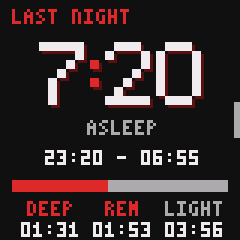
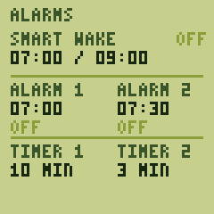

# ur

Finally, a smartwatch firmware for the 90s: as subtle as a retro watch,
but with modern conveniences.

ur, named after an archaic Norwegian word for a timepiece, runs on the
[PineTime] and syncs with [Gadgetbridge] on Android.

<p align="center">
  
  
  
  
  
</p>

<p align="center">
  
  
  
  
</p>

It does what you'd expect of a smartwatch (time, notifications, steps,
heart rate, alarms, timers, music control), and these on top:

- **Quiet nights:** once you fall asleep, or nap, notifications neither
  buzz nor light the screen, and touches don't wake it, until your alarm
  or you're up. Alarms, timers, calls, and "find my watch" still ring.
- **Sleep stages and smart wake:** light, deep, and REM sleep, from
  movement and heart rate. Smart wake rings in the half hour before your
  time, as soon as you stir from light sleep, and alarms build up from
  faint taps.
- **Adaptive heart rate:** every 2 to 20 minutes, more often after you
  move, while you sleep, or while it's high, and only once your wrist is
  still, so the LED isn't spent on readings that fail.
- **A dim glance:** turn your wrist, and the time shows dimly for a few
  seconds without lighting the screen. While Google Maps, OsmAnd, or
  CoMaps navigates, so does the next turn, with two taps as it comes
  within 50 m.
- **Media gestures:** long-press the clock face to play or pause, and
  double-tap to skip, on a glance or with the screen off too; a buzz
  says it took.
- **Screens in four directions** around the clock: the past to one side,
  alarms to the other, notifications above, music and settings below.
- **A button grid** for Home Assistant or Tasker: nine buttons that make
  90 codes (1–9, and pairs like 2 then 3), each tapped, double-tapped,
  or held, sent over Bluetooth (BTHome) or through Gadgetbridge. See
  [docs/buttons.md](docs/buttons.md).
- **The room's air:** a nearby [Aranet4] (with Smart Home integrations
  on) gives the clock face the room's temperature, and its CO₂ gets a
  screen. Without one, the watch estimates the room from its own warmth,
  learning from any Aranet4 it meets: roughly ±2–3 °C on the wrist once
  it has, worse before, in the cold, or while you exercise.
- **Follows the sun:** two dark themes after sunset and two light ones
  by day, and a screen that's brightest while the sun is up and dim from
  midnight until you get up.
- **Gadgetbridge without gaps:** with [InfiniTime]'s protocol,
  Gadgetbridge records steps and heart rate only while connected, and no
  sleep. ur speaks the [Bangle.js protocol] instead, so stock
  Gadgetbridge fetches its minute-by-minute history whenever it
  reconnects.
- **Nothing lost:** before the battery runs flat, or when put away in
  storage mode, the watch saves what the phone hasn't fetched and
  switches off. A crash restarts it at once, and leaves a backtrace in
  the [logging build](#installing)'s log.
- **Releases you can check:** each one rebuilds byte for byte from its
  tag, and carries a GitHub attestation (see [Verifying](#verifying)).

**Caveats:** ur is experimental and personal: it's tested on two
watches, and heart rate and sleep are still being tuned against a
Garmin, so treat sleep stages as a rough guide. It needs an Android phone
with Gadgetbridge, which can't install updates on a Bangle.js, so those
go through another app or a computer. Once it has switched off (a flat
battery, or storage mode), the watch doesn't know the time, or ring
alarms, until the phone reconnects.

**How it was built:** in Rust, on [embassy]. It was written largely by
Claude (Anthropic's model), steered and tested on real hardware by a
human. That's me, Jon, 👋, but yes, this is very much LLM-written,
Jon-guided! Although I'm also quite happy with what I've now landed on,
and am daily driving this in real life :)

[PineTime]: https://pine64.org/devices/pinetime/
[Gadgetbridge]: https://gadgetbridge.org
[Bangle.js protocol]: https://www.espruino.com/Gadgetbridge
[InfiniTime]: https://github.com/InfiniTimeOrg/InfiniTime
[Aranet4]: https://aranet.com
[embassy]: https://embassy.dev

## Using it

In Gadgetbridge, add the watch "Bangle.js ur", and type the passkey the
watch shows when Android asks to pair. Gadgetbridge then syncs
everything on its own, and passes sleep and heart rate on to [Health
Connect] if you like. For the themes to follow your sun rather than
Oslo's, the phone has to share its location: see
[C03](#c03-the-watch-never-gets-a-location-from-the-phone).

**The clock face** shows the time, date, battery, heart rate, the next
alarm or timer, and the room's temperature: a nearby Aranet4's
(underlined at the °), or else estimated from the watch's own on the
wrist, or the watch's own off it. Steps fill ten blocks of 1,000 (×1K)
towards 10,000, then of 10,000 (×10K); Today has the exact count. A bar
along the top means unseen notifications; a note in the top left, that
music is playing; a crossed-out Bluetooth rune there, that the phone
isn't connected.

**Screens:** swipe right for Today (steps and heart rate by the hour),
then Last night; left for Alarms, the alarms set in Gadgetbridge, then
Info; down for the last three notifications; up for the button grid (if
on), Music, Air (while an Aranet4 is near: its CO₂, temperature,
humidity and pressure), then Settings. A short bar on an edge means
there's more that way.

**Touch and button:**

- **Wake** the screen with the button, or a firm tap away from the edge
  (brushes don't count). During a quiet night, only the button wakes it.
- **The button** goes back to the clock, or off from it. It also
  silences a call or stops an alarm, and a double press ends a quiet
  night.
- **Long-press** (the watch buzzes once it's taken, at 0.6 s) plays or
  pauses on the clock face, switches an alarm or timer on or off, and on
  Info, offers storage mode.
- **Double-tap** the clock face for the next track. Tap lightly to skip
  without waking the screen; a firm first tap wakes it. Without a phone
  connected, a double tap wakes the screen instead.
- **A ringing alarm:** tap to snooze for 9 minutes; press the button to
  stop it.

On Settings, tap **THEME** for the next theme, **LIGHT** to switch
brightness from AUTO to SOFT, a step dimmer, for a longer battery, and
**BUTTONS** to turn on the [button grid](docs/buttons.md). To set
an alarm or timer, tap it, then swipe the hours and minutes. Alarms set
in Gadgetbridge are read-only on the watch; a one-off one switches
itself off once it has rung, without Gadgetbridge hearing of it, so
switch it off and on there to set it again.

Gadgetbridge forwards directions from Google Maps and OsmAnd by default;
turn CoMaps on in its settings, under "Navigation apps".

[Health Connect]: https://developer.android.com/health-and-fitness/guides/health-connect

## Installing

Download `ur-<version>-dfu.zip` from the [releases]: the same package
installs ur over InfiniTime and updates it afterwards.
`ur-logging-<version>-dfu.zip` is the same firmware keeping a log in the
watch's flash, for reporting problems; it costs a little battery, and
[CONTRIBUTING.md](CONTRIBUTING.md#field-logs) explains fetching the log.

Send the zip over Bluetooth with either of these:

- **Nordic's [nRF Device Firmware Update][nrf-dfu-android] app** (also
  on the [App Store][nrf-dfu-ios]): select File, the ZIP ("Distribution
  packet") type, and the zip; then Device, the watch ("InfiniTime" the
  first time, "Bangle.js ur" after that); then Start. For updates, use
  the phone Gadgetbridge paired with the watch: the app relies on that
  pairing (see [U01](#u01-a-phone-update-fails-at-enabling-bootloader-or-with-gatt-conn-timeout)).
- **A Linux computer**, with `scripts/dfu.py` from this repository
  (`pip install bleak` first). `<MAC>` is the watch's address, which
  `bluetoothctl` shows while scanning.

  ```sh
  # The first install:
  python3 scripts/dfu.py ur-<version>-dfu.zip --address <MAC>
  # Updates, once paired in bluetoothctl (agent KeyboardOnly,
  # default-agent, pair <MAC>, then type the passkey the watch shows),
  # take about half a minute:
  python3 scripts/dfu.py ur-<version>-dfu.zip --address <MAC> --packet-size 240
  ```

[releases]: https://github.com/jonhoo/ur/releases
[nrf-dfu-android]: https://play.google.com/store/apps/details?id=no.nordicsemi.android.dfu
[nrf-dfu-ios]: https://apps.apple.com/app/nrf-device-firmware-update/id1624454660

### The first install, over InfiniTime

1. On InfiniTime 1.16 or later, turn on the OTA switch in Settings. If
   you're sending with the nRF app and Gadgetbridge is connected to
   InfiniTime, disconnect it there: InfiniTime takes one connection at a
   time, so the app wouldn't find the watch.
2. Send the zip. If the nRF app stalls at 14% with "GATT CONN TIMEOUT"
   (InfiniTime's side of the transfer), send it from a computer instead.
3. The watch shows the PINE64 logo for about a minute while the
   bootloader swaps the images. Leave it be until ur's clock face
   appears.
4. In Gadgetbridge, remove the InfiniTime device, and add "Bangle.js ur"
   (see [Using it](#using-it)). The watch keeps ur once the phone has
   synced the time; until then, a reset puts InfiniTime back.

### Updating

Send a newer zip; Gadgetbridge can stay connected. The watch resets into
the new version, and keeps it once Gadgetbridge has synced the time
again; a reset before that goes back to the old one. Today's steps, and
the activity the phone hasn't fetched, carry over.

To roll back by hand, hold the button for about 7 seconds, until the
watch resets into the [bootloader], and keep holding: release when the
logo turns blue for the previous firmware, or red for PINE64's recovery
firmware, a minimal InfiniTime to reinstall from.

[bootloader]: https://github.com/InfiniTimeOrg/pinetime-mcuboot-bootloader

### Verifying

Each release file carries a GitHub [attestation][attestations]. To check
that a download is exactly what this repository's release workflow
built, with the [GitHub CLI][gh attestation verify]:

```sh
gh attestation verify ur-<version>-dfu.zip --repo jonhoo/ur
```

Releases are also reproducible: [CONTRIBUTING.md](CONTRIBUTING.md#releasing)
shows how to rebuild one and compare.

[attestations]: https://docs.github.com/en/actions/security-for-github-actions/using-artifact-attestations/using-artifact-attestations-to-establish-provenance-for-builds
[gh attestation verify]: https://cli.github.com/manual/gh_attestation_verify

## FAQ

When the watch points you here, it shows an entry's code: a letter for
its area (C connectivity, U updates, P power, S sensors, D display and
touch, A alarms, N notifications, E errors), and a number.

### C01: The watch says "NOT PAIRED"

A phone or computer connected without pairing, and ur only talks to
devices paired with its passkey. In Gadgetbridge, add the watch (or
remove it and add it again), and when Android asks to pair, type the
6-digit passkey the watch shows.

### C02: The watch says "PAIRING LOST"

The watch remembers pairing with this phone, but the phone has forgotten
it, for instance after the watch was removed from Android's Bluetooth
settings. Remove the watch from both Android's Bluetooth settings and
Gadgetbridge, then add it again in Gadgetbridge and type the passkey.

### C03: The watch never gets a location from the phone

Without one, the themes and brightness follow the sun in Oslo. The watch
asks Gadgetbridge for the phone's location when it connects (at most
once an hour, and when the time zone changes), and keeps the last one.
Gadgetbridge only passes on fresh locations, and only with all of these
on:

1. In the watch's settings in Gadgetbridge: "Use phone GPS data", with
   "Only use network to determine location" off (with it on, no location
   ever arrived in testing).
2. In Gadgetbridge's own settings, under Location: "Keep location
   updated".
3. In Android's settings for Gadgetbridge: location permission "Allow
   all the time", and location itself on.

Phones without Google Play services may have no network location, so
nothing arrives indoors until the watch happens to ask while the phone
is outside.

### C04: The watch says "INTENTS OFF"

Gadgetbridge didn't pass a [button grid](docs/buttons.md) press on to
other apps: turn on "Allow Intents" in the watch's settings in
Gadgetbridge.

### N01: Notifications don't buzz, and the screen stays dim

The watch thinks you're asleep: it's a quiet night. It ends with the
morning's first alarm, or once you've been up for 22 minutes (7 after a
nap, which is sleep between 09:00 and 20:00). If you're up before
either, double-press the button.

### N02: The watch says "TEXT AS BITMAPS"

Gadgetbridge's "Text as Bitmaps" is on: it sends what the watch's font
can't show as pictures, which ur shows as `?` (and long messages full of
them never arrive). Switch it off in the watch's settings in
Gadgetbridge, under Notifications.

### P01: How do I put the watch away for a while?

Use storage mode: long-press the Info screen (swipe left from the clock,
past Alarms and any alarms from Gadgetbridge), then tap to confirm. The watch saves the activity the phone
hasn't fetched and switches itself off, using roughly 40% of a full
charge in six weeks. Press the button or plug in the charger to wake
it; the phone sets the time when it reconnects, and gets the saved
activity with its next sync.

### U01: A phone update fails at "Enabling bootloader" or with "GATT CONN TIMEOUT"

The nRF Device Firmware Update app only works over a paired link: if the
phone hasn't paired with the watch, the app tries a different kind of
update, and fails. Pair first (see [C01](#c01-the-watch-says-not-paired)
and [C02](#c02-the-watch-says-pairing-lost)), then send the update again.

### U02: The watch says "UPDATE REFUSED"

The update arrived, but the watch checked it before installing it and
found something wrong: it was damaged or cut short on the way, or it
isn't firmware for this watch (a zip for another device, say). The watch
keeps the firmware it has. Send the zip again; if it's refused again,
download it again, and [verify](#verifying) it.

## Contributing

[CONTRIBUTING.md](CONTRIBUTING.md) covers building, iterating on a dev
kit, fetching logs from a sealed watch, and making releases.

## License

Licensed under either of

 * Apache License, Version 2.0
   ([LICENSE-APACHE](LICENSE-APACHE) or <http://www.apache.org/licenses/LICENSE-2.0>)
 * MIT license
   ([LICENSE-MIT](LICENSE-MIT) or <http://opensource.org/licenses/MIT>)

at your option.

The firmware images also contain third-party code under its own terms:

- Nordic Semiconductor's Bluetooth controller and protocol scheduler
  (through the `nrf-sdc` and `nrf-mpsl` crates), provided in binary form
  under the Nordic 5-Clause licence, which only permits their use with
  Nordic chips, such as the PineTime's nRF52832.
- `src/bma423_config.bin`, Bosch's BMA423 feature-engine configuration,
  under the BSD-3-Clause licence in `src/bma423_config.LICENSE`.

## Contribution

Unless you explicitly state otherwise, any contribution intentionally
submitted for inclusion in the work by you, as defined in the Apache-2.0
license, shall be dual licensed as above, without any additional terms or
conditions.
