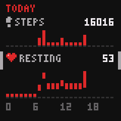

# ur

Firmware for the [PineTime] smartwatch: a pixel-art watch face that keeps
out of your way, with alarms, sleep and heart-rate tracking, and phone
integration through [Gadgetbridge]. ("Ur" is an older Norwegian word for a
timepiece.)

<p align="center">
  
  
  
  
  
  <br>
  
  
  
  
  
</p>

- **Clock face:** time with seconds, date, battery, steps, heart rate, and
  temperature, in four themes: two dark for after sunset (Arcade and
  Terminal), and two light for the day (Handheld and Parchment), switching
  by themselves at your location's sunset and sunrise. The temperature is
  the watch's own (it has no other sensor): on the wrist it reads close to
  your skin's, around 30 °C; off the wrist, it drifts towards the room's.
- **Glance:** turn your wrist to look, and the time shows dimly for a few
  seconds, without lighting the whole screen. Not while you're asleep.
- **Directions:** while Google Maps, OsmAnd, or CoMaps navigates on the
  phone, a glance shows the next turn: an arrow, the distance, and the
  street, with the time above. The watch taps twice as a turn comes within
  50 m, and shows it.
- **Alarms:** smart wake (rings in the half hour before your time, as soon
  as you stir from light sleep, with separate times for weekdays and
  weekends), two alarms, and two timers, plus up to ten alarms set in
  Gadgetbridge. Alarms start with faint taps and build up to full strength
  over a minute; timers buzz in full straight away.
- **Sleep and heart rate:** measured on the watch, shown there for today
  and last night, and synced to Gadgetbridge (and from there to [Health
  Connect], if you like). Sleep comes in light, deep, and REM stages,
  estimated from your wrist's movement and heart rate: a rough guide,
  tuned against a Garmin on one watch.
- **Notifications:** which app, and who from, briefly; full-screen and
  dim if the screen was off. The last three wait above the clock face,
  with when each came. Calls take over the screen, to answer or decline.
- **Quiet nights and naps:** once you fall asleep, notifications neither
  buzz nor light the screen, touches don't wake it, and it stays dim,
  until the morning's first alarm (or until you're up). Alarms, timers,
  calls, and "find my watch" still ring.
- **Media controls:** with a phone connected, play, pause, and skip from
  the clock face, even with the screen off; previous too, on the music
  screen.
- **Updates:** over Bluetooth, with automatic rollback if an update doesn't
  work out.

Gadgetbridge sees the watch as a Bangle.js: ur speaks the [Bangle.js
protocol], so stock Gadgetbridge works without patches. ur uses it rather
than [InfiniTime]'s because, for an InfiniTime watch, Gadgetbridge records
steps and heart rate only while the phone is connected, and gets no sleep
at all. With the Bangle.js protocol, Gadgetbridge syncs the watch's
minute-by-minute steps, heart rate, and sleep whenever it reconnects, and
shares the phone's location for the sun-based themes; the protocol also
leaves room for more, like weather and calendar. The catch is that
Gadgetbridge doesn't install updates on a Bangle.js, so those go through
another app (see [Installing](#installing)).

**Status:** experimental and personal. It's tested on two watches, and
heart rate and sleep are still being tuned against a Garmin. It was
written largely by Claude (Anthropic's model), steered and tested on real
hardware by a human. That's me, Jon, 👋, but yes, this is very much
LLM-written, Jon-guided! Although I'm also quite happy with what I've
now landed on, and am daily driving this in real life :)

[PineTime]: https://pine64.org/devices/pinetime/
[Gadgetbridge]: https://gadgetbridge.org
[Bangle.js protocol]: https://www.espruino.com/Gadgetbridge
[Health Connect]: https://developer.android.com/health-and-fitness/guides/health-connect

## Using it

- **Connecting a phone:** in Gadgetbridge, add the watch "Bangle.js ur" and
  type the passkey the watch shows when Android asks to pair. The watch only
  talks to a phone that paired this way: if it shows "NOT PAIRED" or
  "PAIRING LOST", see FAQ C01 or C02. Gadgetbridge then syncs time,
  location, notifications, activity, sleep, and heart rate on its own. For
  sun-based themes away from Oslo, the phone has to share its location:
  see FAQ C03.
- **Screens:** around the clock face. Swipe right for today (steps and
  heart rate, by the hour), then last night's sleep; left for alarms, then
  phone alarms (once Gadgetbridge has sent some); down for the last three
  notifications, newest first; up for music (while the phone has some),
  then info. Swipe the same way again to go further, the other way to come
  back. A short bar on a screen's edge means you can swipe that way. A
  coloured one at the top of the clock means new notifications, until you
  swipe down to them.
- **Waking the screen:** press the button, or tap firmly, away from the
  screen's edge. Brief touches and touches near the edge don't wake it,
  so brushing against something doesn't either. Turning your wrist to
  look shows a glance; tap then to wake the screen fully. With a phone
  connected, a tap takes 0.3 s to wake the screen, in case a second
  follows (a double tap is the next track); without one, a double tap
  wakes it too. During a quiet night, touches don't wake it: use the
  button.
- **Button:** back to the clock, or off from the clock. Also silences a
  call, and stops a ringing alarm.
- **Media:** with a phone connected, on the clock face, long-press to play
  or pause, and double-tap for the next track. These work on a glance and
  with the screen off too, leaving it be (but not during a quiet night):
  the watch buzzes to say it took. A note beside the Bluetooth icon means
  something's playing. The music screen has previous, play/pause, and
  next along the bottom.
- **Long-press:** on the alarms screen, an alarm or timer to switch it on
  or off; on the info screen, for storage mode. The watch acts, and
  buzzes, once you've held for 0.6 s, so let go when you feel it.
- **Themes:** tap THEME on the info screen for the next one.
- **Brightness:** brightest while the sun is up, dim from midnight until
  you get up, and in between, medium. For less (and a longer battery),
  tap LIGHT on the info screen to switch from AUTO to SOFT: medium while
  the sun is up, dim otherwise. Glances and quiet nights stay dim either
  way.
- **Setting an alarm or timer:** tap it, then swipe up and down on the
  hours (left) and minutes (right), and tap the bottom left button to
  switch it on or off (or start and stop a timer). Smart wake has a page
  each for weekdays and weekends.
- **A ringing alarm:** tap to snooze for 9 minutes, or press the button to
  stop it. Alarms (but not timers) start with the screen dim, and
  brighten over a minute.
- **Phone alarms:** set them in Gadgetbridge's Alarms screen for the watch;
  they sync whenever you change one, and the watch only shows them. A
  one-off alarm switches itself off on the watch once it has rung, but
  Gadgetbridge doesn't hear of it: to set it again, switch it off and on
  there.
- **Quiet nights** end with the morning's first alarm, once you've been
  up for 22 minutes, or when you double-press the button: the screen
  lights up bright, and notifications buzz again. Until then, the latest
  notification waits on the clock face. Falling asleep between 09:00 and
  20:00 is a nap, which ends after 7 minutes up.
- **Directions:** Gadgetbridge forwards them by default, from Google Maps
  (it reads its navigation notification) and OsmAnd; CoMaps needs turning
  on, under Settings, "Navigation apps". Directions disappear when
  navigation ends, or after three minutes without an update.
- **Storage mode,** for putting the watch away: long-press the info
  screen, then tap. The watch saves the activity the phone hasn't
  fetched and switches off. Press the button or plug in the charger to
  wake it. Off, it uses roughly 40% of a full charge in six weeks.
- **An empty battery:** before it runs flat (below about 3.4 V for a
  minute), the watch saves the activity the phone hasn't fetched, shows
  "BATTERY EMPTY", and switches off. Plug in the charger to wake it.
- **After switching off,** the watch doesn't know the time (or show
  steps, or ring alarms) until the phone reconnects. The phone then gets
  the saved activity with its next sync.

## Installing

The PineTime's bootloader only accepts firmware over Bluetooth, from the
firmware that's running. ur receives updates the same way [InfiniTime] does,
so one package, `ur-<version>-dfu.zip`, installs it over InfiniTime and
updates it afterwards.

Download it from the [releases]. Each file there carries a GitHub
[attestation][attestations]; to check that a download is exactly what
this repository's release workflow built, with the
[GitHub CLI][gh attestation verify]:

```sh
gh attestation verify ur-<version>-dfu.zip --repo jonhoo/ur
```

[releases]: https://github.com/jonhoo/ur/releases
[InfiniTime]: https://github.com/InfiniTimeOrg/InfiniTime
[attestations]: https://docs.github.com/en/actions/security-for-github-actions/using-artifact-attestations/using-artifact-attestations-to-establish-provenance-for-builds
[gh attestation verify]: https://cli.github.com/manual/gh_attestation_verify

### Sending the package

Use whichever of these suits you:

**Nordic's nRF Device Firmware Update app** (Android and iOS; first
install and updates):

1. Install "nRF Device Firmware Update" by Nordic Semiconductor from the
   [Play Store][nrf-dfu-android] or [App Store][nrf-dfu-ios], and copy the
   zip onto the phone.
2. On the first install, if Gadgetbridge is connected to InfiniTime,
   disconnect it there first: InfiniTime takes one connection at a time,
   so the app wouldn't find it. (ur takes a second connection
   alongside the phone's, so for updates Gadgetbridge can stay connected.)
3. Select File, choose the ZIP ("Distribution packet") type, and pick
   the zip.
4. Select Device, and pick the watch: "InfiniTime" for the first install,
   "Bangle.js ur" after that.
5. Start, and wait for the transfer to finish.

The app connects using the phone's existing Bluetooth pairing. ur only
accepts updates from a device paired with its passkey, so for updates use
the phone that Gadgetbridge paired with the watch. (InfiniTime needs no
pairing.)

**Gadgetbridge** (Android; first install only, untried so far):

1. Add the watch, still running InfiniTime, as a new device in Gadgetbridge
   (it shows up as "InfiniTime"), and let it pair and connect.
2. While it's connected, open the zip from a file manager and pick
   Gadgetbridge's firmware installer ("Open with" → Gadgetbridge).
3. Tap Install.

After that, Gadgetbridge knows the watch as a Bangle.js, and its Bangle.js
support doesn't install firmware: use one of the other two for updates.

**A Linux computer** with Bluetooth, using `scripts/dfu.py` from this
repository (needs [bleak]: `pip install bleak`). `<MAC>` is the watch's Bluetooth
address, which `bluetoothctl` shows while scanning.

- First install:

  ```sh
  python3 scripts/dfu.py ur-<version>-dfu.zip --address <MAC>
  ```

- Updates: pair once in `bluetoothctl` (`agent KeyboardOnly`,
  `default-agent`, `pair <MAC>`, then type the passkey the watch shows).
  Then this takes about half a minute:

  ```sh
  python3 scripts/dfu.py ur-<version>-dfu.zip --address <MAC> --packet-size 240
  ```

[nrf-dfu-android]: https://play.google.com/store/apps/details?id=no.nordicsemi.android.dfu
[nrf-dfu-ios]: https://apps.apple.com/app/nrf-device-firmware-update/id1624454660
[bleak]: https://github.com/hbldh/bleak

On the first install, the nRF app on Android stopped at 14% every time
("GATT CONN TIMEOUT"), apparently InfiniTime stalling its radio
mid-transfer. If that happens, use a computer.

### First install, over InfiniTime

1. On InfiniTime 1.16 or later, turn on the OTA switch in Settings.
2. Send the zip with any of the methods above.
3. The watch resets and shows the PINE64 logo for about a minute while the
   bootloader swaps the images. Leave it alone until the ur clock face
   appears.
4. In Gadgetbridge, remove the InfiniTime device, then add "Bangle.js ur"
   (see [Using it](#using-it)). The watch keeps ur once the phone has synced
   the time with it. Until then, any reset puts InfiniTime back.

### Updating

Send a newer zip with the nRF Device Firmware Update app or
`scripts/dfu.py`. The watch shows a progress bar, resets into the new
version, and keeps it once Gadgetbridge reconnects and syncs the time. If
the watch resets before that, it goes back to the previous version.
Today's steps, and the activity Gadgetbridge hasn't fetched yet, carry
over.

### Rolling back

Hold the button. After about 7 seconds the watch resets into the
bootloader. Keep holding while the logo shows: release when it turns blue to
go back to the previous firmware. Holding until it turns red installs
PINE64's recovery firmware from the SPI flash, a minimal InfiniTime to
reinstall from. (This is the [bootloader] every PineTime ships with.)

[bootloader]: https://github.com/InfiniTimeOrg/pinetime-mcuboot-bootloader

## FAQ

Each entry has a code: a letter for its area (C connectivity, U updates,
P power, S sensors, D display and touch, A alarms, N notifications, E
errors the watch reports), and a number. When the watch points you here,
it shows the code.

### C01: The watch says "NOT PAIRED"

A phone or computer connected without pairing with the watch. ur only
talks to devices paired with its passkey. In Gadgetbridge, add the watch
(or remove it and add it again), and when Android asks to pair, type the
6-digit passkey the watch shows.

### C02: The watch says "PAIRING LOST"

The watch remembers pairing with this phone, but the phone has forgotten
it (it reconnected without the shared key), for instance after the watch
was removed from Android's Bluetooth settings. Remove the watch from both
Android's Bluetooth settings and Gadgetbridge, then add it again in
Gadgetbridge and type the passkey.

### C03: The watch never gets a location from the phone

Without one, the sun-based themes and brightness follow the sun in Oslo.
The watch asks Gadgetbridge for the phone's location when it connects (at
most once an hour, and again when the time zone changes), and keeps the
last one it got. Gadgetbridge only passes on fresh locations, never the
last known one, and drops them unless all of these are on:

1. In the watch's settings in Gadgetbridge: "Use phone GPS data", with
   "Only use network to determine location" off. With it on, no location
   ever arrived in testing, even indoors; with it off, Gadgetbridge uses
   both GPS and network location, and a network fix came within a second.
2. In Gadgetbridge's own settings, under Location: "Keep location
   updated".
3. In Android's settings for the Gadgetbridge app: location permission
   "Allow all the time" (Gadgetbridge asks from the background), and
   location itself on.

Phones without Google Play services may have no network location: then
nothing comes indoors, until the watch happens to ask while the phone is
outside.

### N01: Notifications don't buzz, and the screen stays dim

The watch thinks you're asleep: it's a quiet night (see [Using
it](#using-it)). It ends with the morning's first alarm, or once you've
been up for 22 minutes (7 after a nap). If you're up before either,
double-press the button.

### P01: How do I put the watch away for a while?

Use storage mode: long-press the Info screen (swipe up from the clock,
past Music if the phone has some), then tap to confirm. The watch saves
the activity the phone hasn't fetched yet and switches itself off almost
completely, using roughly 40% of a full charge in six weeks. Press the
button or plug in the charger to wake it; the phone sets the time again
when it reconnects, and gets the saved activity with its next sync.

### U01: A phone update fails at "Enabling bootloader" or with "GATT CONN TIMEOUT"

The nRF Device Firmware Update app only works over a paired link: if the
phone hasn't paired with the watch, the app tries a different kind of
update, and fails. Pair first (see [C01](#c01-the-watch-says-not-paired)
and [C02](#c02-the-watch-says-pairing-lost)), then send the update again.

## Contributing

[CONTRIBUTING.md](CONTRIBUTING.md) covers building, iterating on a dev kit,
fetching logs from a sealed watch, and making releases. To report a
problem with a watch, it also explains the `ur-logging` build, whose log
helps.

## License

Licensed under either of

 * Apache License, Version 2.0
   ([LICENSE-APACHE](LICENSE-APACHE) or <http://www.apache.org/licenses/LICENSE-2.0>)
 * MIT license
   ([LICENSE-MIT](LICENSE-MIT) or <http://opensource.org/licenses/MIT>)

at your option.

The firmware images also contain third-party code under its own terms:

- Nordic Semiconductor's Bluetooth controller and protocol scheduler
  (through the `nrf-sdc` and `nrf-mpsl` crates), provided in binary form
  under the Nordic 5-Clause licence, which only permits their use with
  Nordic chips, such as the PineTime's nRF52832.
- `src/bma423_config.bin`, Bosch's BMA423 feature-engine configuration,
  under the BSD-3-Clause licence in `src/bma423_config.LICENSE`.

## Contribution

Unless you explicitly state otherwise, any contribution intentionally
submitted for inclusion in the work by you, as defined in the Apache-2.0
license, shall be dual licensed as above, without any additional terms or
conditions.
