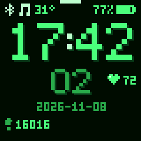
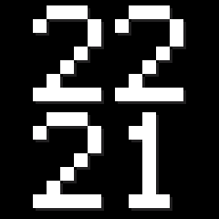
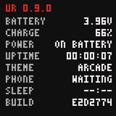

# ur

Firmware for the [PineTime] smartwatch: a pixel-art watch face that keeps
out of your way, with alarms, sleep and heart-rate tracking, and phone
integration through [Gadgetbridge].

<p align="center">
  
  
  
  
  <br>
  
  
  
  
</p>

- **Clock face:** time with seconds, date, battery, steps, and heart rate,
  in four themes: two dark for after sunset (Arcade and Terminal), and two
  light for the day (Handheld and Parchment), switching by themselves at
  your location's sunset and sunrise.
- **Glance:** turn your wrist to look, and the time shows dimly for a few
  seconds, without lighting the whole screen. Not while you're asleep.
- **Alarms:** smart wake (rings in the half hour before your time, as soon
  as you stir from light sleep, with separate times for weekdays and
  weekends), two alarms, and two timers.
- **Sleep and heart rate:** measured on the watch, and synced to
  Gadgetbridge (and from there to [Health Connect], if you like).
- **Notifications:** which app, and who from, briefly. With the screen off
  they're full-screen and dim. Calls take over the screen, and you can
  answer or decline.
- **Media controls:** play, pause, next, and previous, while something is
  playing.
- **Updates:** over Bluetooth, with automatic rollback if an update doesn't
  work out.

Gadgetbridge sees the watch as a Bangle.js: ur speaks the [Bangle.js
protocol], so stock Gadgetbridge works without patches.

**Status:** experimental and personal. It's tested on two watches, and
heart rate and sleep are still being tuned against a Garmin. It was
written largely by Claude (Anthropic's model), steered and tested on real
hardware by a human.

[PineTime]: https://pine64.org/devices/pinetime/
[Gadgetbridge]: https://gadgetbridge.org
[Bangle.js protocol]: https://www.espruino.com/Gadgetbridge
[Health Connect]: https://developer.android.com/health-and-fitness/guides/health-connect

## Using it

- **Button:** wakes the screen. Silences a call, and stops a ringing alarm.
- **Swipe left and right:** between the clock, alarms, music (while
  something is playing), and info screens.
- **Long-press:** the next theme. On the alarms screen, long-pressing an
  alarm or timer switches it on or off instead.
- **Tap an alarm or timer** to set it: swipe up and down to change the
  time, then the left button switches it on or off (or starts and stops a
  timer).
- **A ringing alarm:** tap to snooze for 9 minutes, or press the button to
  stop it.
- **Connecting a phone:** in Gadgetbridge, add the watch "Bangle.js ur" and
  type the passkey the watch shows. Gadgetbridge then syncs time, location,
  notifications, activity, sleep, and heart rate on its own. For sun-based
  themes away from Oslo, turn on "Use phone GPS data" in the watch's
  Gadgetbridge settings.

## Installing

The PineTime's bootloader only accepts firmware over Bluetooth, from the
firmware that's running. ur receives updates the same way [InfiniTime] does,
so one package, `ur-<version>-dfu.zip`, installs it over InfiniTime and
updates it afterwards.

Download it from the [releases]. Each file there carries a GitHub
[attestation][attestations]; to check that a download is exactly what
this repository's release workflow built, with the
[GitHub CLI][gh attestation verify]:

```sh
gh attestation verify ur-<version>-dfu.zip --repo jonhoo/ur
```

[releases]: https://github.com/jonhoo/ur/releases
[InfiniTime]: https://github.com/InfiniTimeOrg/InfiniTime
[attestations]: https://docs.github.com/en/actions/security-for-github-actions/using-artifact-attestations/using-artifact-attestations-to-establish-provenance-for-builds
[gh attestation verify]: https://cli.github.com/manual/gh_attestation_verify

### Sending the package

Use whichever of these suits you:

**Nordic's nRF Device Firmware Update app** (Android and iOS; first
install and updates):

1. Install "nRF Device Firmware Update" by Nordic Semiconductor from the
   [Play Store][nrf-dfu-android] or [App Store][nrf-dfu-ios], and copy the
   zip onto the phone.
2. On the first install, if Gadgetbridge is connected to InfiniTime,
   disconnect it there first: InfiniTime takes one connection at a time,
   so the app wouldn't find it. (ur takes a second connection
   alongside the phone's, so for updates Gadgetbridge can stay connected.)
3. Select File, choose the ZIP ("Distribution packet") type, and pick
   the zip.
4. Select Device, and pick the watch: "InfiniTime" for the first install,
   "Bangle.js ur" after that.
5. Start, and wait for the transfer to finish.

The app connects using the phone's existing Bluetooth pairing. ur only
accepts updates from a device paired with its passkey, so for updates use
the phone that Gadgetbridge paired with the watch. (InfiniTime needs no
pairing.)

**Gadgetbridge** (Android; first install only, untried so far):

1. Add the watch, still running InfiniTime, as a new device in Gadgetbridge
   (it shows up as "InfiniTime"), and let it pair and connect.
2. While it's connected, open the zip from a file manager and pick
   Gadgetbridge's firmware installer ("Open with" → Gadgetbridge).
3. Tap Install.

After that, Gadgetbridge knows the watch as a Bangle.js, and its Bangle.js
support doesn't install firmware: use one of the other two for updates.

**A Linux computer** with Bluetooth, using `scripts/dfu.py` from this
repository (needs [bleak]: `pip install bleak`). `<MAC>` is the watch's Bluetooth
address, which `bluetoothctl` shows while scanning.

- First install:

  ```sh
  python3 scripts/dfu.py ur-<version>-dfu.zip --address <MAC>
  ```

- Updates: pair once in `bluetoothctl` (`agent KeyboardOnly`,
  `default-agent`, `pair <MAC>`, then type the passkey the watch shows).
  Then this takes about half a minute:

  ```sh
  python3 scripts/dfu.py ur-<version>-dfu.zip --address <MAC> --packet-size 240
  ```

[nrf-dfu-android]: https://play.google.com/store/apps/details?id=no.nordicsemi.android.dfu
[nrf-dfu-ios]: https://apps.apple.com/app/nrf-device-firmware-update/id1624454660
[bleak]: https://github.com/hbldh/bleak

On the first install, the nRF app on Android stopped at 14% every time
("GATT CONN TIMEOUT"), apparently InfiniTime stalling its radio
mid-transfer. If that happens, use a computer.

### First install, over InfiniTime

1. On InfiniTime 1.16 or later, turn on the OTA switch in Settings.
2. Send the zip with any of the methods above.
3. The watch resets and shows the PINE64 logo for about a minute while the
   bootloader swaps the images. Leave it alone until the ur clock face
   appears.
4. In Gadgetbridge, remove the InfiniTime device, then add "Bangle.js ur"
   (see [Using it](#using-it)). The watch keeps ur once the phone has synced
   the time with it. Until then, any reset puts InfiniTime back.

### Updating

Send a newer zip with the nRF Device Firmware Update app or
`scripts/dfu.py`. The watch shows a progress bar, resets into the new
version, and keeps it once Gadgetbridge reconnects and syncs the time. If
the watch resets before that, it goes back to the previous version.

### Rolling back

Hold the button. After about 7 seconds the watch resets into the
bootloader. Keep holding while the logo shows: release when it turns blue to
go back to the previous firmware. Holding until it turns red installs
PINE64's recovery firmware from the SPI flash, a minimal InfiniTime to
reinstall from. (This is the [bootloader] every PineTime ships with.)

[bootloader]: https://github.com/InfiniTimeOrg/pinetime-mcuboot-bootloader

## Contributing

[CONTRIBUTING.md](CONTRIBUTING.md) covers building, iterating on a dev kit,
fetching logs from a sealed watch, and making releases. To report a
problem with a watch, it also explains the `ur-logging` build, whose log
helps.

## License

Licensed under either of

 * Apache License, Version 2.0
   ([LICENSE-APACHE](LICENSE-APACHE) or <http://www.apache.org/licenses/LICENSE-2.0>)
 * MIT license
   ([LICENSE-MIT](LICENSE-MIT) or <http://opensource.org/licenses/MIT>)

at your option.

The firmware images also contain third-party code under its own terms:

- Nordic Semiconductor's Bluetooth controller and protocol scheduler
  (through the `nrf-sdc` and `nrf-mpsl` crates), provided in binary form
  under the Nordic 5-Clause licence, which only permits their use with
  Nordic chips, such as the PineTime's nRF52832.
- `src/bma423_config.bin`, Bosch's BMA423 feature-engine configuration,
  under the BSD-3-Clause licence in `src/bma423_config.LICENSE`.

## Contribution

Unless you explicitly state otherwise, any contribution intentionally
submitted for inclusion in the work by you, as defined in the Apache-2.0
license, shall be dual licensed as above, without any additional terms or
conditions.
